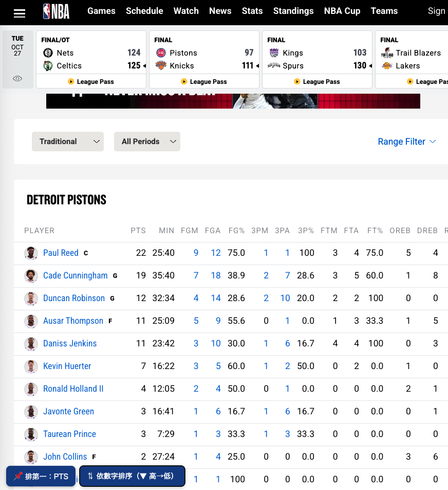

# NBA Box Score 欄位置前與排序

在 NBA.com 的 box score 頁面左下角加入兩個按鈕：

- **📌 排第一**：選擇任一欄位（PTS、REB、AST…）移到球員名字後面
- **⇅ 依數字排序**：依該欄位排序，循環切換「高到低 → 低到高 → 還原」

## 安裝

1. 瀏覽器先安裝 [Tampermonkey（篡改猴）](https://www.tampermonkey.net/)
2. **[點此安裝腳本](https://raw.githubusercontent.com/killnopig/nba-boxscore-sort/main/nba-boxscore-sort.user.js)**
3. 在跳出的畫面按「安裝」
4. 打開任一場 NBA.com 的 box score 頁面即可使用

## 截圖

## 說明

- 只在瀏覽器端調整顯示，不會修改 NBA.com 的任何資料
- 本專案為非官方工具，與 NBA 無關
- 沒有收集或傳送任何個人資料

## 更新紀錄

- **2.0.0**：新增兩個按鈕，可自選欄位置前與排序
- **1.2**：修正被頁面還原的問題

## 授權

MIT License

   ## 新增
   - ⭐ 預設配置按鈕：內建 9 種配置，可儲存自訂配置
   - 自動記住上次選的欄位與排序
